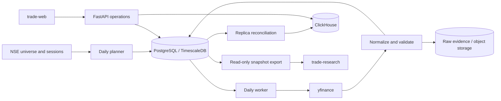

# Daily backend architecture

The application has one Python distribution and image. FastAPI serves operational
reads and guarded daily-work requests; Dagster runs the planner and worker. Provider
requests run in workers, not in candle read handlers.

PostgreSQL owns work identities, leases, retries, universe lifecycle, calendar,
canonical OHLCV and audit state. Redis coordinates provider request budgets; it is
not a durable work queue. The worker checks quality before publishing and records
ClickHouse replica counts and digests. Raw evidence uses immutable, digest-verified
objects. Missing history and quarantined rows remain explicit coverage exceptions.

Daily contracts and storage ports separate pipeline logic from infrastructure.
Endpoints and credentials come from configuration. The API has read-only analytical
credentials; the worker receives explicit write roles. CORS and trusted admin
identity protect mutations. Upstox daily support remains dormant and separately
labeled; no intraday acquisition or aggregation is registered or retained.

Local Compose supplies optional reference infrastructure. Production deployments
reuse existing storage and retain volumes. Package-origin changes require an idle
Dagster daemon, heartbeat expiry and schedule reconciliation. Frontend deployment
and research computation have their own repositories and release cycles.

Historical schema definitions and applied migration files remain part of the
compatibility boundary. Their presence does not grant a runtime research or filing
capability. See [current state](current_state.md) and [acceptance status](repository_split_progress.md).
